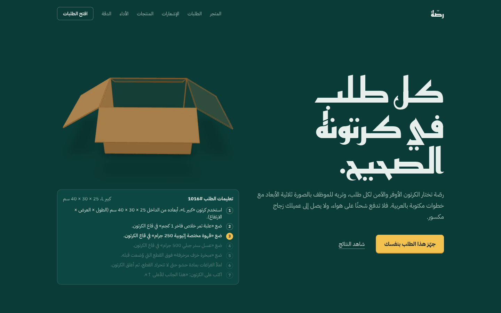
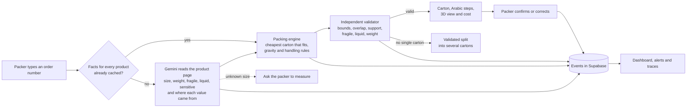
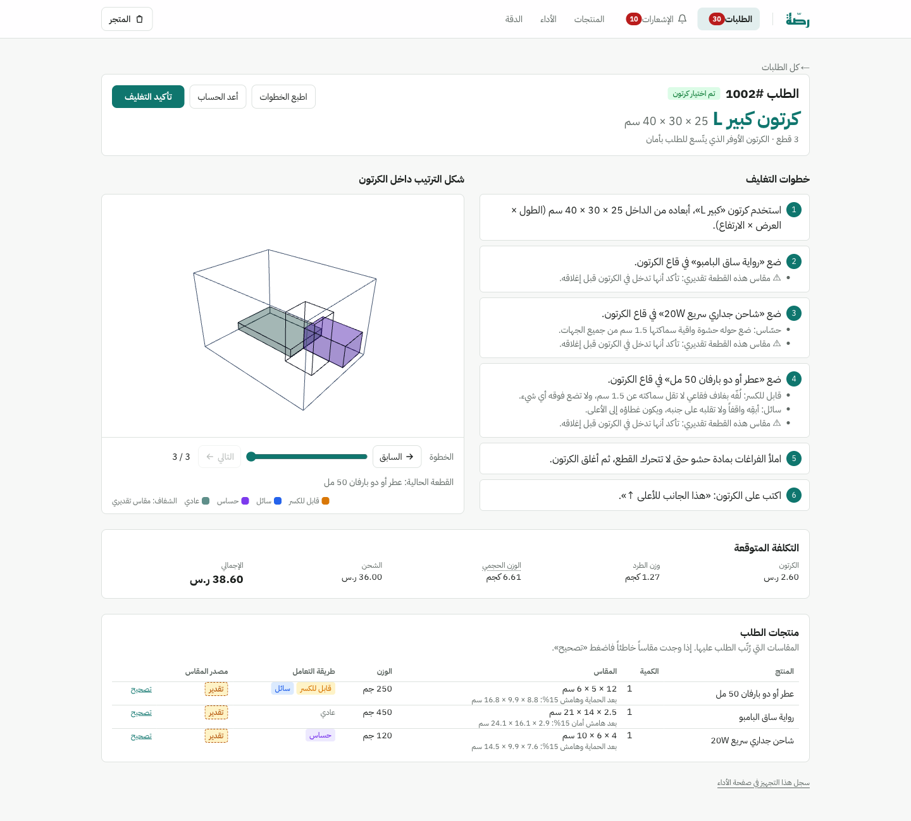
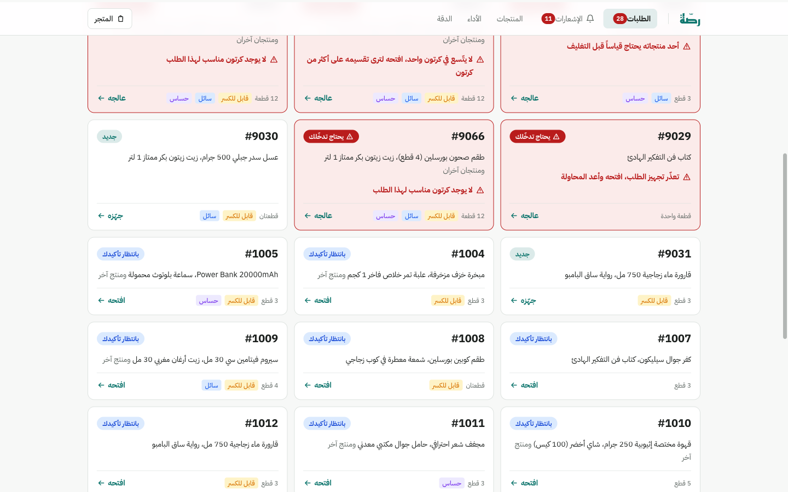
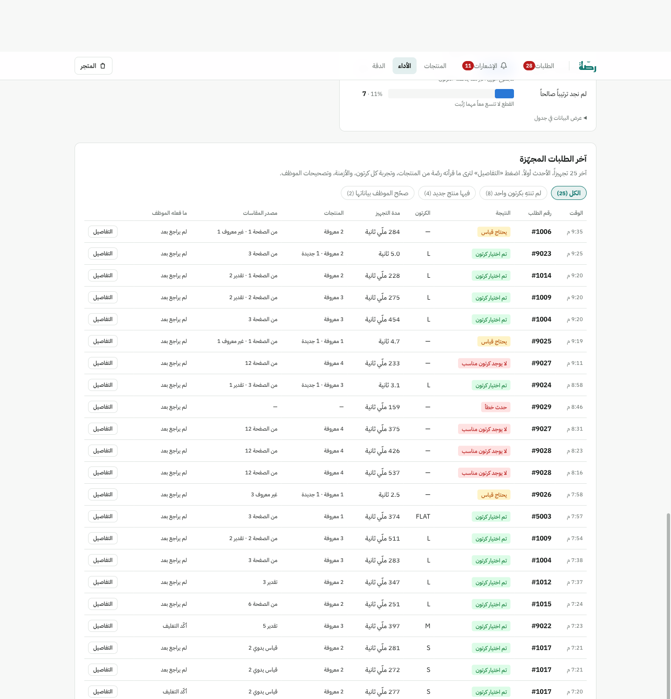
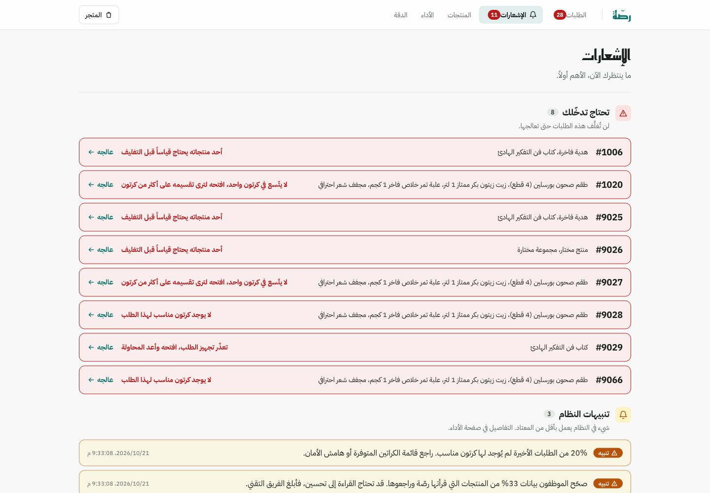
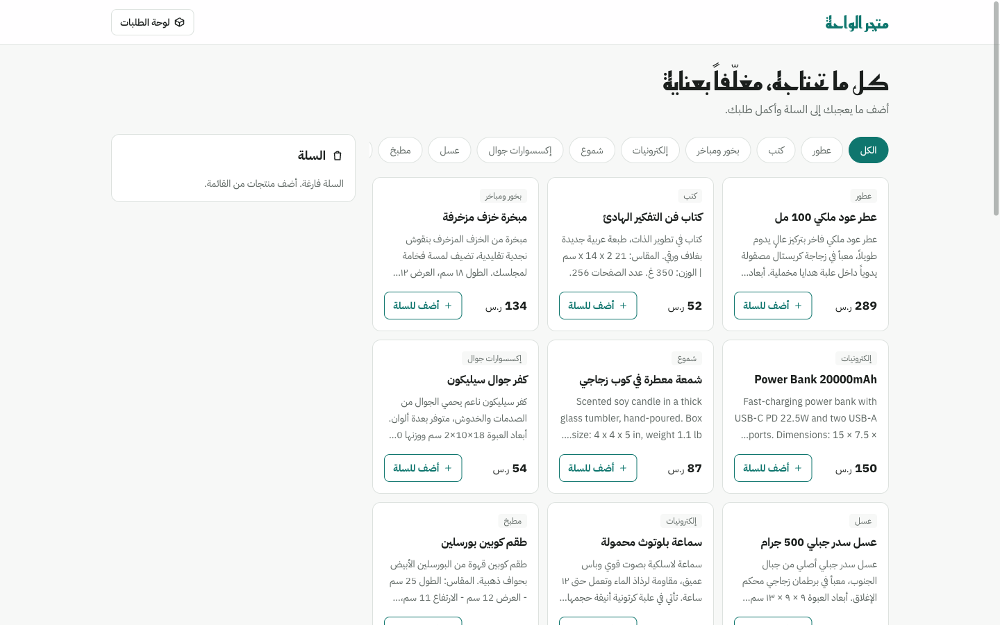
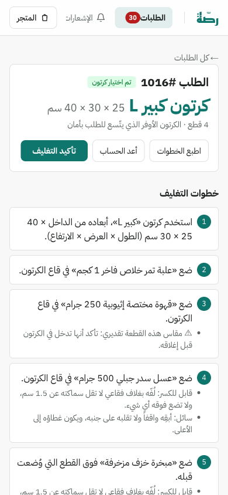

# Rassah (رصّة)

**An AI packing assistant for Saudi online stores: every order in the right carton.**

[](https://rassah.vercel.app)
[](https://github.com/justAbdulaziz10/Rassah/actions/workflows/ci.yml)

[](LICENSE)

> [!NOTE]
> **This is an MVP built in two days.** Tuwaiq Academy asked us, in *Project 1: AI Product Development and Monitoring* (Tuwaiq Academy × Startupbootcamp × Meta), to come up with an AI product idea ourselves and build it end to end in two days (20 to 22 October 2026). The product had to be deployed so anyone can try it, and monitored in production. This repository is that MVP. It runs on synthetic data, has no login, and is not connected to a real store. [What the MVP is and isn't](#mvp-scope) lists the limits.



## Contents

- [Try it now](#try-it-now)
- [The idea](#the-idea)
- [How it works](#how-it-works)
- [Screens](#screens)
- [Results](#results)
- [Monitoring](#monitoring)
- [MVP scope](#mvp-scope)
- [Run it locally](#run-it-locally)
- [Project structure](#project-structure)
- [Documentation](#documentation)
- [Tech stack](#tech-stack)
- [Team](#team)
- [بالعربي](#بالعربي)

## Try it now

The app is live at **https://rassah.vercel.app**. There is no account to create: anyone with the link can use it. The whole interface is in Arabic.

1. **Place an order as a customer.** Open the [store](https://rassah.vercel.app/store) (متجر الواحة), add a few products to the cart and check out. You get an order number from 5001 up.
2. **Pack it as the packer.** Open [Orders](https://rassah.vercel.app/orders) (الطلبات), type your order number and press «افتح». Rassah picks the cheapest carton that holds the order safely. You get numbered packing steps in Arabic, a 3D view you can step through, and the estimated carton and shipping cost.
3. **Try the prepared orders:**

   | Order | What it shows |
   |---|---|
   | **1001** | A single book goes into the flat carton. |
   | **1002** | The perfume's page gives no size. Gemini estimates it from "50 مل", marks it «تقدير», and the engine adds a safety margin and keeps the bottle upright. |
   | **1016** | A mixed gift basket: the honey jar stays upright and the fragile incense burner goes on top. |
   | **1017** | No usable size on the page, so Rassah asks the packer to measure instead of guessing. |
   | **1020** | About 20.5 kg, too much for any single carton, so Rassah splits it into several validated cartons. |

4. **Correct the AI.** On a result, press «تصحيح» next to a product and change a measurement. The order is packed again, and the correction counts toward the main quality metric (M1).
5. **Look behind the scenes.**
   - [Performance](https://rassah.vercel.app/monitoring) (الأداء): the seven metrics, charts and alerts, plus a full trace of every order.
   - [Notifications](https://rassah.vercel.app/notifications) (الإشعارات): what needs attention now.
   - [Products](https://rassah.vercel.app/catalog) (المنتجات): what Rassah learned about each product.
   - [Accuracy](https://rassah.vercel.app/evaluation) (الدقة): the offline evaluation results.

> [!TIP]
> Orders numbered **9001 and up** are mock history, written by `npm run demo:data` so every state can be shown (problems, alerts, corrections). The products, orders, cartons and prices are all synthetic. Everyone shares the one demo database, so what you pack is visible to other visitors.

## The idea

### The problem

Small merchants who ship multi-item orders pick a carton by eye, and three things go wrong:

1. **Cartons that are too big.** Couriers bill by chargeable weight, `max(actual weight, L × W × H / 5000)`. An oversized carton raises the shipping bill even when the products are light.
2. **Broken items and returns.** A new packer puts a book on top of a perfume bottle, or lays an oil bottle on its side.
3. **Missing product data.** Professional cartonization tools assume clean dimensions already sit in a warehouse system. Small Saudi stores don't have that data. It lives as free text on their product pages, in Arabic and English, in every format: "٣٠×٢٠×١٠ سم", "12 x 8 x 4 in", "100 مل", or nothing at all.

### The solution

The packer types an order number. Rassah has an LLM (Google Gemini) read each product's page and pull out its dimensions and weight, and whether it is fragile, liquid or sensitive. A 3D packing engine then picks the cheapest carton that holds the order without breaking any handling rule. An independent validator checks the layout before anyone sees it. The packer gets the carton, step-by-step instructions and a 3D layout, and can confirm it or correct it.

### Why it needs AI, and where

| Step | Done by | Why this tool |
|---|---|---|
| Understand messy product text and classify handling needs | **Gemini (LLM)** | Rules and regex break on free-form text. "كريستال" means fragile without the word "fragile" appearing. |
| Place items in a carton with gravity and handling rules | **Search-based packing engine** (classical AI search) | An LLM cannot guarantee collision-free coordinates. Geometry needs exact computation. |
| Prove the layout is physically valid | **Independent validator** (plain math) | Correctness is checked by code that shares no logic with the engine. |

*"The LLM understands, the engine computes, the validator proves."*

Rassah never makes up a number. Each value records where it came from:

- **«من الصفحة»:** read straight from the product page.
- **«تقدير»:** estimated from other clues, such as "100 مل" or a page count, then given a 15% safety margin.
- **«قياس يدوي»:** measured by a person.
- When nothing usable exists, the product is blocked with a "measure this product" prompt instead of a guess.

Each product is read once and cached, so later orders that contain it are fast and free.

**Users:** the **packer** packs orders and corrects what's wrong. The **operations lead** watches quality, speed, cost and failures on the dashboard.

## How it works



1. **Order lookup.** The order comes from Rassah's own database (seeded orders and the built-in store). A read-only client for an external store's Orders API, such as Salla, exists but is off unless configured.
2. **Extraction.** Gemini returns structured JSON: dimensions, weight, flags, the source of each value and a confidence level, with a quote from the page as evidence. Each call is logged with its status, latency, tokens and cost.
3. **Packing.** A corner-point search tries several item orderings per carton, cheapest carton first. If those fail, it adds seeded random restarts and a bounded backtracking search. Fragile items go on top, liquids stay upright, and every item needs enough support underneath. When no single carton can hold the order, it proposes a split into up to four cartons.
4. **Validation.** Separate code re-checks every layout. A layout that fails is never shown.
5. **Result.** The packer sees the carton, numbered Arabic steps, a 3D view with a step slider, and the cost: carton plus shipping on dimensional weight.
6. **Feedback.** "Confirm" and "correct" are recorded. A correction updates the cached facts and counts against the AI's accuracy.

More detail: [docs/diagrams.md](docs/diagrams.md) has the development flow, monitoring flow and system architecture diagrams.

## Screens

| | |
|---|---|
|  |  |
| **Order result:** carton, numbered steps, 3D layout, cost, and where each measurement came from. | **Orders:** the packer's queue. Orders that need attention come first, each with its reason. |
|  |  |
| **Performance:** open alerts, a health list, the seven metrics, charts and per-order traces. | **Notifications:** orders that need the packer, system alerts, new orders and orders waiting for confirmation. |
|  |  |
| **Store:** a demo shop on the same database. Its orders show up in the queue. | **On a phone:** every screen works at phone width. |

Dark mode is supported too: [monitoring in dark mode](docs/screens/08-monitoring-dark.png).

## Results

All numbers come from offline evaluations on the **synthetic** dataset (30 products, 20 orders, 60 packing fixtures, 200 random orders). Sources: [docs/report/results.md](docs/report/results.md), `eval/results/`.

| What we measured | Result |
|---|---|
| Engine layouts that pass the independent validator | **100%** (40/40 fixtures; 258/258 feasible cases in the benchmark) |
| Impossible orders falsely reported as packed | **0 / 20** |
| Naive packer layouts that break a handling rule | 20 of 28 (71%): liquid tipped over, item on a fragile one, floating |
| Carton plus shipping cost vs the naive packer, on the 84 orders both pack validly | **8.3% cheaper** (31.35 vs 34.19 SAR per order) |
| Extraction: dimensions and weight stated on the page | 100% correct (within 1 cm and 10%) |
| Extraction: products with no size info answered "unknown" instead of guessed | 100% |
| Extraction: error of estimated dimensions | 12.9% overall, 16.1% on the held-out products |
| Gemini cost per product read | about $0.00045 (paid once, then cached) |

Read the results honestly:

- **What was measured is safety, not savings.** The cost gain comes from synthetic tariffs on synthetic orders.
- **The safety margin doesn't cover every estimate.** The held-out estimate error (16.1%) is above the 15% margin, so Rassah tells the packer to check the fit for estimated sizes.

## Monitoring

Every product read, packing run and packer action is written to Supabase as an event. The [Performance](https://rassah.vercel.app/monitoring) page computes seven metrics for the last hour, 24 hours, 7 days or all time. Each metric shows its limit and how many cases it is based on.

| Code | Metric | Why it matters |
|---|---|---|
| M1 | Products the packer had to correct | The main AI-quality signal |
| M2 | Where measurements came from (page, estimate, manual, unknown) | Shows how complete the store's product pages are |
| M3 | Layouts rejected by the validator | Must stay 0; anything else is an engine bug |
| M4 | Orders with no suitable carton | Points to a missing carton size or too large a margin |
| M5 | Time to prepare an order (p95), for known vs new products | Speed for the packer |
| M6 | Product reads that failed (by reason) | Gemini outages, rate limits and timeouts |
| M7 | AI cost per order and cache hit rate | Running cost |

When a metric crosses its limit, an alert opens, from info up to critical. It shows on the dashboard, on the notifications page and in the bell count, and can also go to a Discord or Slack webhook. The alert resolves itself once the metric recovers. Each order has a trace showing the products read, every carton tried and why it was rejected, timings, tokens and corrections. A demo switch (`?outage=1`) simulates a Gemini outage, to show the alerts firing and then resolving. Details: [docs/stack/06-monitoring.md](docs/stack/06-monitoring.md).

## MVP scope

**In the MVP:**

- AI extraction with a fallback chain: page value, then estimate, then manual measurement.
- A catalog cache.
- 3D packing with handling rules, an independent validator and a multi-carton split.
- Arabic packing steps, a 3D view and a cost estimate.
- Confirm and correct actions.
- An order queue and a notifications page.
- A built-in demo store.
- Event logging, seven metrics, alerts and traces.
- Offline evaluations.
- CI and a production deploy.

**Not in the MVP, on purpose:**

- **Data:** the products, orders, cartons and shipping prices are all synthetic, modeled on Saudi store pages. No real merchant catalog or pilot was used.
- **Integrations:** no live Salla or Zid integration and no live web scraping. The external Orders API client is read-only and off by default.
- **Access:** no login, accounts or per-merchant data. Everyone shares one demo database.
- **Products:** no clothing or other deformable items. The target is rigid, box-shaped products such as perfume, cosmetics, electronics accessories, books and home goods.
- **Courier rates:** no real courier rate APIs.

**Known limitations and next steps:**

- **No login on the write APIs.** There are no accounts or per-merchant data, and everyone shares one database. The per-IP rate limits live in process memory, so they slow abuse down but are not a hard cap. Next: authentication and per-merchant isolation.
- **Ground truth is AI-drafted.** The extraction ground truth was drafted with AI help and not independently reviewed, so treat the extraction accuracy numbers as indicative.
- **Estimates and the split are approximate.** Estimated sizes carry a 15% margin and the packing steps say to check the fit. The multi-carton split is validated but not proven to be the cheapest. Next: a cheaper split search and stacking-load rules.
- **The vendor benchmark has not run against the vendors.** `npm run bench` needs Paccurate and 3DBinPacking keys; results so far compare Rassah with a naive packer only.
- **Free-tier Gemini.** `gemini-3.5-flash-lite` on the free tier allows 15 requests per minute. A burst of new products can hit that limit; Rassah reports it as `rate_limited` and never guesses.
- **Not yet built:** real Salla and Zid integration, real courier rates, manufacturer-spec lookup for branded products, a scale-weight check on packed orders, and a pilot on real orders comparing carton spend, damage and packing time.

## Run it locally

**Prerequisites:** Node.js 24 LTS (see `.nvmrc`), npm and Git.

```bash
git clone https://github.com/justAbdulaziz10/Rassah.git
cd Rassah
npm ci
cp .env.example .env.local     # then fill in the values (see "Environment variables" below)
npm run check                  # lint + typecheck + data validation + unit tests
npm run dev                    # http://localhost:3000
```

**No Supabase or Gemini key?** Put `DATA_BACKEND=memory` and `DEMO_MODE=true` in `.env.local`. The app then runs on the mock store from `data/*.json`, held in memory. This mode is local only and ignored on Vercel.

- **Without a Gemini key:** product facts are pre-loaded from the synthetic test set (`data/ground_truth.json`) with origin `seeded`. They are labelled «محفوظة في الكتالوج» and never shown as AI output, so the demo orders pack with no network.
- **Turning seeding off:** set `MEMORY_SEED_FACTS=false`. Products are then reported as "needs measurement", never guessed.
- **Mock history:** add `MEMORY_MOCK_DATA=true` to load the same mock history `npm run demo:data` writes.
- **Health check:** in this mode `/api/health` answers 200 with `status: "degraded"` and `offline: true`.

### Scripts

| Script | What it does |
|---|---|
| `npm run dev` | Local dev server |
| `npm run build` / `npm start` | Production build / serve it |
| `npm run check` | Lint, typecheck, data validation and tests. Run it before every push. |
| `npm test` | Unit tests (Vitest, no network) |
| `npm run validate-data` | Validates the synthetic dataset in `data/` |
| `npm run seed` | Loads the mock store into Supabase (needs `.env.local`) |
| `npm run gen-fixtures` | Regenerates the packing evaluation fixtures in `data/` |
| `npm run eval:packing` | Packing evaluation: engine vs naive baseline, no network. `-- --write` saves the results JSON |
| `npm run eval:extraction` | Extraction evaluation against ground truth. Calls Gemini and costs tokens |
| `npm run bench` | Head-to-head packing benchmark (protocol in [docs/benchmark.md](docs/benchmark.md)) |
| `npm run demo:data -- --apply` | Writes the mock history to Supabase so every page shows every state. The history is orders 9001+ (tagged `demo = 'mock'`) in each queue state and attention reason, with every product-read failure, corrections, slow reads, a validator rejection and the alerts they cause. It ends at the moment you run it, so run it shortly before showing the app. `-- --remove` deletes exactly those rows and resolves the alerts they caused |
| `npm run clear-facts -- --product p-16` | Deletes one product's cached facts so the next order reads it again (`--all --yes` clears all) |

`scripts/reset-events.ts --yes` deletes all monitoring events and alerts but keeps facts and eval runs. Run it with `npx tsx --env-file-if-exists=.env.local`. `GET /api/health` reports whether the Gemini key and the database are available, and never returns secret values.

### Database setup

Apply `supabase/migrations/0001_init.sql` to your Supabase project once: paste it into the Supabase SQL editor or use the Supabase MCP `apply_migration` tool. Then load the mock store (30 products, 20 orders, 5 cartons, shipping rates):

```bash
npm run seed
```

The migration creates 12 tables with row-level security enabled and no public policies. The app reads and writes only through the server-side service-role key.

### Environment variables

Copy `.env.example` to `.env.local`. Never commit real values, and never give a server-only variable a `NEXT_PUBLIC_` prefix.

| Variable | Required | Purpose |
|---|---|---|
| `GEMINI_API_KEY` | for live extraction | Google AI Studio key |
| `GEMINI_MODEL` | for live extraction | `gemini-3.5-flash-lite` |
| `GEMINI_PRICE_INPUT_PER_M` | optional | USD per 1M input tokens, for the cost metric: `0.30` |
| `GEMINI_PRICE_OUTPUT_PER_M` | optional | USD per 1M output tokens, including thinking: `2.50` |
| `SUPABASE_URL`, `SUPABASE_SERVICE_ROLE_KEY` | for the database | Server-side database access |
| `DATA_BACKEND` | optional | `memory` runs on `data/*.json` in process memory, with no Supabase (local only, ignored on Vercel) |
| `MEMORY_SEED_FACTS` | optional | Memory mode only: `auto` (default: seed only when there is no Gemini key), `true` or `false`. Seeded facts have origin `seeded` and are never shown as AI output |
| `MEMORY_MOCK_DATA` | optional | Memory mode only: `true` loads the same mock history as `npm run demo:data` at start-up |
| `STORE_API_URL`, `STORE_API_KEY` | optional | An external store's Orders API (for example Salla later). When both are set, an order number that isn't in Rassah's database is read from it, read-only. `/store` needs neither |
| `DEMO_MODE` | optional | `true` enables demo controls: fault injection (`/orders/<id>?outage=1`), re-extract and clear cached facts |
| `ALERT_WEBHOOK_URL` | optional | Discord or Slack webhook for alerts |

> This project uses Next.js 16 with Cache Components. Several APIs differ from older Next.js versions, so read `AGENTS.md` and the docs in `node_modules/next/dist/docs/` before writing pages or routes.

## Project structure

```
app/
  page.tsx               landing page (its hero replays a real engine result for order 1016)
  (console)/             the working screens: orders, notifications, catalog, monitoring, evaluation
  store/                 the built-in demo store
  api/                   orders (pack), products (facts), runs, monitoring, health, store checkout
components/              UI: result page, 3D view, dashboard, tables
lib/
  ai/                    Gemini extraction: prompt, JSON schema, retries, cost
  engine/                packing search, independent validator, cost model, Arabic instructions, split
  pipeline/              one order end to end: facts, packing, events, alerts
  monitoring/            the seven metrics, alert rules, dashboard data
  db/                    Repo interface with Supabase and in-memory backends
  orders/ store/ integrations/ demo/ ui/
data/                    synthetic products, orders, cartons, ground truth, packing fixtures
eval/results/            stored evaluation and benchmark results
scripts/                 seed, evaluations, benchmark and mock history
supabase/migrations/     database schema
tests/                   Vitest unit, property and pipeline tests
docs/                    decisions, diagrams, stack guides and the report
```

## Documentation

| Document | What it covers |
|---|---|
| [docs/decisions.md](docs/decisions.md) | Every technical choice, with its reason and the alternatives |
| [docs/diagrams.md](docs/diagrams.md) | Development flow, monitoring flow and system architecture |
| [docs/report/REPORT.md](docs/report/REPORT.md) | Final report ([PDF](https://github.com/justAbdulaziz10/Rassah/releases/download/v1.0.0/REPORT.pdf)), with [results](docs/report/results.md) and the [AI tools log](docs/report/TOOLS.md). The slide deck ([PDF](https://github.com/justAbdulaziz10/Rassah/releases/download/v1.0.0/deck.pdf), [PowerPoint](https://github.com/justAbdulaziz10/Rassah/releases/download/v1.0.0/deck.pptx)) and the [demo video](https://github.com/justAbdulaziz10/Rassah/releases/download/v1.0.0/demo.mp4) are attached to the [v1.0.0 release](https://github.com/justAbdulaziz10/Rassah/releases/tag/v1.0.0) |
| [docs/stack/01-nextjs-typescript.md](docs/stack/01-nextjs-typescript.md) | Next.js app: routes, pages, API handlers, folder layout, UI and RTL |
| [docs/stack/02-gemini-extraction.md](docs/stack/02-gemini-extraction.md) | Gemini API: extraction prompt, JSON schema, fallback chain, confidence, caching and errors |
| [docs/stack/03-packing-engine.md](docs/stack/03-packing-engine.md) | Packing engine, independent validator, cost model, packing instructions and split |
| [docs/stack/04-supabase.md](docs/stack/04-supabase.md) | Database schema, migrations, access rules and seed data |
| [docs/stack/05-3d-visualization.md](docs/stack/05-3d-visualization.md) | The 3D layout view (react-three-fiber) and its fallback |
| [docs/stack/06-monitoring.md](docs/stack/06-monitoring.md) | Events, the seven metrics, alert rules, the dashboard and fault injection |
| [docs/stack/07-evaluation.md](docs/stack/07-evaluation.md) | Offline evaluation: datasets, metrics, scripts and how results reach the report |
| [docs/stack/08-testing-quality.md](docs/stack/08-testing-quality.md) | Vitest, ESLint, TypeScript strict mode and the test list |
| [docs/stack/09-vercel-ci.md](docs/stack/09-vercel-ci.md) | Vercel deployment and GitHub Actions CI |
| [docs/benchmark.md](docs/benchmark.md) | Head-to-head packing benchmark protocol |

## Tech stack

| Layer | Choice |
|---|---|
| App framework | Next.js 16 (App Router, Cache Components) and TypeScript (strict) |
| UI | React 19, Tailwind CSS 4, Arabic RTL layout, light and dark mode |
| AI | Google Gemini API via `@google/genai` (`gemini-3.5-flash-lite`, configurable) |
| Packing engine | Team-written TypeScript: corner-point search with fixed strategies, seeded restarts and a bounded backtracking search, a multi-carton split and an independent validator |
| Database and event store | Supabase (Postgres) via `@supabase/supabase-js` |
| 3D view | `@react-three/fiber` and `@react-three/drei` |
| Charts | Recharts |
| Tests and quality | Vitest (285 tests), ESLint, `tsc --noEmit` |
| Hosting and CI | Vercel (production on `main`, Frankfurt region) and GitHub Actions |

## Team

Built in two days by:

| Name | GitHub | LinkedIn |
|---|---|---|
| **Abdulaziz Alkhlaiwe** | [@justAbdulaziz10](https://github.com/justAbdulaziz10) | [abdulaziz-alkhlaiwe](https://www.linkedin.com/in/abdulaziz-alkhlaiwe) |
| **Hana Alshamrani** | [@enghanamansour](https://github.com/enghanamansour) | [hana-alshamrani-855946228](https://www.linkedin.com/in/hana-alshamrani-855946228) |
| **Bayan Alkathiri** | [@Bayan369](https://github.com/Bayan369) | [bayan-alkathiri-3069bsa](https://www.linkedin.com/in/bayan-alkathiri-3069bsa) |

The work was split into three areas:

| Area | Covers |
|---|---|
| AI & Data | Gemini extraction, the synthetic dataset, the extraction evaluation |
| Engine & UI | Packing engine, validator, cost, instructions, result page, 3D view |
| Platform & Monitoring | Next.js app, Supabase, events, dashboard, alerts, Vercel, CI |

Made for *Project 1: AI Product Development and Monitoring*, Tuwaiq Academy × Startupbootcamp × Meta, October 2026. AI coding tools (Claude Code) drafted most of the code and documentation. The team reviewed it, and tests and evaluations verified it; the full log is in [docs/report/TOOLS.md](docs/report/TOOLS.md).

## بالعربي

**رصّة** مساعد ذكي لتغليف طلبات المتاجر الإلكترونية السعودية. يكتب الموظف رقم الطلب، فتقرأ رصّة صفحة كل منتج بالذكاء الاصطناعي (Gemini) وتستخرج مقاسه ووزنه، وتعرف هل هو قابل للكسر أو سائل أو حساس. بعدها يختار محرك تغليف ثلاثي الأبعاد أرخص كرتون يتّسع للطلب بأمان، ويتحقق مدقّق مستقل من الترتيب قبل عرضه. يحصل الموظف على الكرتون وخطوات تغليف مرقّمة بالعربية وصورة ثلاثية الأبعاد والتكلفة المتوقعة، وكل خطوة تُسجَّل وتظهر في لوحة المراقبة مع التنبيهات.

**جرّبه:** افتح [المتجر](https://rassah.vercel.app/store) واطلب منتجات، ثم افتح [الطلبات](https://rassah.vercel.app/orders) واكتب رقم طلبك. وجرّب أيضاً الطلبات 1001 و1002 و1020، وشاهد [لوحة الأداء](https://rassah.vercel.app/monitoring).

## License

[MIT](LICENSE)
