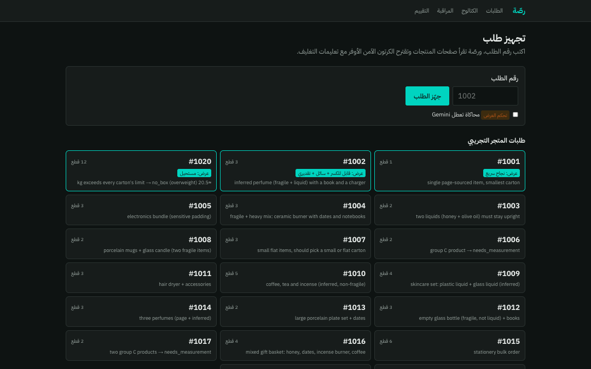
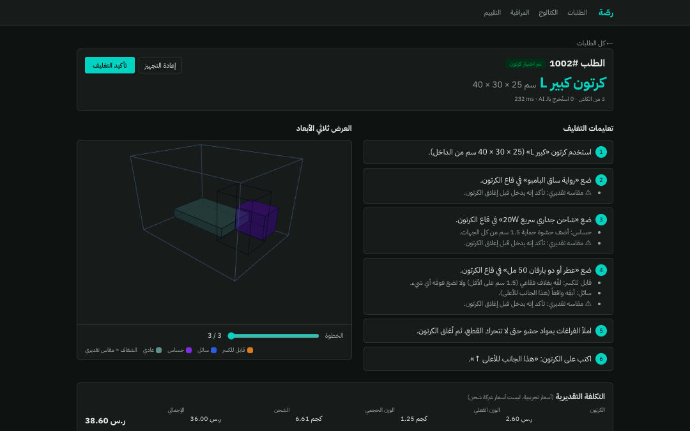
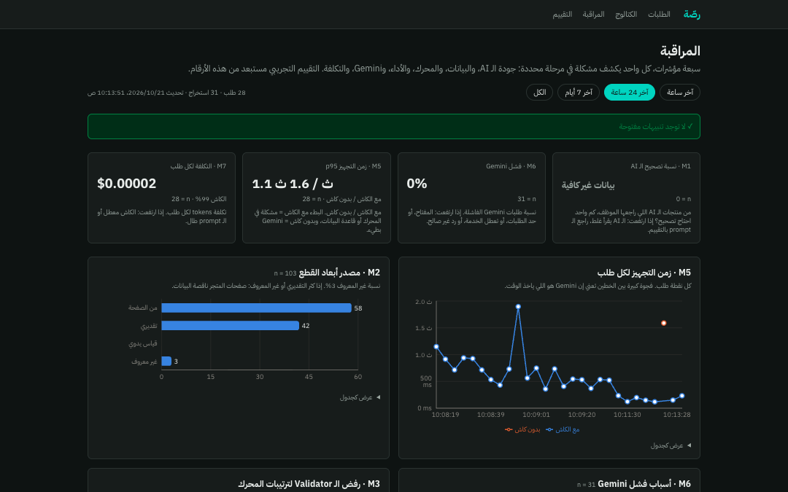
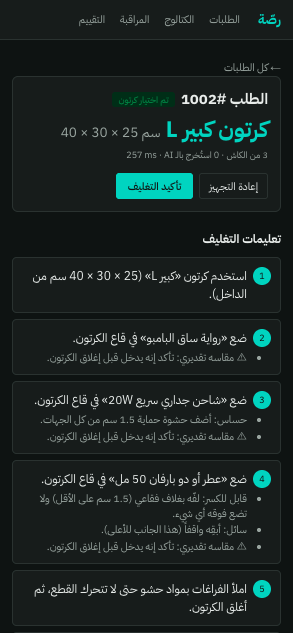

# Rassah (رصّة)

**AI packing assistant for Saudi e-commerce merchants.**

A packer types an order number. Rassah reads each product's page with an LLM (Gemini), extracts dimensions and weight, and flags whether the product is fragile, liquid or sensitive. A constrained 3D packing engine then picks the cheapest carton that holds the order safely. The packer gets the carton, step-by-step packing instructions and a 3D view of the layout. Every step is logged to Supabase and shown on a monitoring dashboard.

**Live:** https://rassah.vercel.app · store (place an order, then pack it in /orders): https://rassah.vercel.app/store

**Pages:** `/` is now a landing page (its hero replays a real engine result for order 1016); the working screens are `/orders`, `/catalog`, `/monitoring` and `/evaluation`.

> Status: **MVP live**. Repository: https://github.com/justAbdulaziz10/Rassah. The implementation follows [`docs/PLAN.md`](docs/PLAN.md).
> Built for *Project 1: AI Product Development and Monitoring* (Tuwaiq Academy × Startupbootcamp × Meta). Demo day: **Thursday 22 October 2026**.

## Screenshots

| | |
|---|---|
|  |  |
| Orders: the packer picks an order to pack. | Order 1002: chosen carton, numbered Arabic packing steps and cost. |
|  |  |
| Monitoring: the seven metrics and per-run traces. | Order 1002 on a phone-width screen. |

## Getting started

**Prerequisites:** Node.js 24 LTS (see `.nvmrc`), npm, Git.

```bash
git clone https://github.com/justAbdulaziz10/Rassah.git
cd Rassah
npm ci
cp .env.example .env.local     # then fill in the values (see "Environment variables" below)
npm run check                  # lint + typecheck + data validation + unit tests
npm run dev                    # http://localhost:3000
```

| Script | What it does |
|---|---|
| `npm run dev` | Local dev server |
| `npm run build` / `npm start` | Production build / serve it |
| `npm run check` | Lint + typecheck + data validation + tests. Run before every push. |
| `npm test` | Unit tests (Vitest, no network) |
| `npm run validate-data` | Validates the synthetic dataset in `data/` |
| `npm run seed` | Loads the mock store into Supabase (needs `.env.local`) |
| `npm run gen-fixtures` | Regenerates the packing evaluation fixtures in `data/` |
| `npm run eval:packing` | Packing evaluation (engine vs naive baseline, no network). `-- --write` saves the results JSON |
| `npm run demo:morning` | Demo-morning readiness check against production: health, DB counts, 4 sample packs, open alerts. `-- --reset` first clears events (keeps eval runs and facts). `BASE_URL` overrides the target |
| `npm run eval:extraction` | Extraction evaluation against ground truth (calls Gemini, costs tokens) |

`GET /api/health` reports whether the Gemini key and the database are available. It never returns secret values.

**No Supabase yet?** Put `DATA_BACKEND=memory` (and `DEMO_MODE=true`) in `.env.local`. The app then runs on the mock store from `data/*.json` held in memory. This is local only, ignored on Vercel, and also the offline fallback for demo day. Without a Gemini key, product facts are pre-loaded from the synthetic test set (`data/ground_truth.json`) and labelled "بيانات تجريبية" (seeded, not AI), so the demo orders pack with no network; group C products still need measurement. Set `MEMORY_SEED_FACTS=false` to turn this off (products are then reported as "needs measurement", never guessed). In this mode `/api/health` answers 200 with `status: "degraded"` and `offline: true`.

## Database setup

Apply `supabase/migrations/0001_init.sql` to your Supabase project once, either by pasting it into the Supabase SQL editor or with the Supabase MCP `apply_migration` tool. Then load the mock store (30 products, 20 orders, 5 cartons, shipping rates):

```bash
npm run seed
```

The migration creates 12 tables with row-level security enabled and no public policies. The app reads and writes only through the server-side service-role key. Without Supabase, use `DATA_BACKEND=memory` (below).

## Environment variables

Copy `.env.example` to `.env.local`. Never commit real values; server-only variables must never get a `NEXT_PUBLIC_` prefix.

| Variable | Required | Purpose |
|---|---|---|
| `GEMINI_API_KEY` | for live extraction | Google AI Studio key |
| `GEMINI_MODEL` | for live extraction | `gemini-3.5-flash-lite` |
| `GEMINI_PRICE_INPUT_PER_M` | optional | USD per 1M input tokens for the cost metric: `0.30` |
| `GEMINI_PRICE_OUTPUT_PER_M` | optional | USD per 1M output tokens (incl. thinking): `2.50` |
| `SUPABASE_URL`, `SUPABASE_SERVICE_ROLE_KEY` | for the database | Server-side database access |
| `DATA_BACKEND` | optional | `memory` runs on `data/*.json` in process memory, no Supabase (local only, ignored on Vercel) |
| `MEMORY_SEED_FACTS` | optional | Memory mode only: `auto` (default, seed only when no Gemini key), `true`, `false`. Seeded facts are labelled "بيانات تجريبية", never shown as AI output |
| `DEMO_MODE` | optional | `true` enables demo controls (fault injection, re-extract, clear cached facts) |
| `ENGINE_VERSION`, `PROMPT_VERSION` | optional | Stamped into events and eval runs |
| `ALERT_WEBHOOK_URL` | optional | Discord/Slack webhook for alerts |

> Next.js 16 with Cache Components is used. Read `AGENTS.md` and the docs in `node_modules/next/dist/docs/` before writing pages or routes. Several APIs differ from older Next.js versions.

## Documentation

| Document | What it covers |
|---|---|
| [docs/CHECKLIST.md](docs/CHECKLIST.md) | **Single source of truth for progress**: 517 tasks in 13 phases, gates, credentials register, env matrix, blockers log |
| [docs/PLAN.md](docs/PLAN.md) | Master plan: problem, MVP scope, architecture, timeline, team ownership, deliverables, risks |
| [docs/diagrams.md](docs/diagrams.md) | Required diagrams: development flow and monitoring flow, plus the system architecture |
| [docs/stack/01-nextjs-typescript.md](docs/stack/01-nextjs-typescript.md) | Next.js app: routes, pages, API handlers, folder layout, UI and RTL |
| [docs/stack/02-gemini-extraction.md](docs/stack/02-gemini-extraction.md) | Gemini API: extraction prompt, JSON schema, fallback chain, confidence, caching, errors |
| [docs/stack/03-packing-engine.md](docs/stack/03-packing-engine.md) | Packing engine, independent validator, cost model, packing instructions |
| [docs/stack/04-supabase.md](docs/stack/04-supabase.md) | Database schema, migrations, access rules, seed data |
| [docs/stack/05-3d-visualization.md](docs/stack/05-3d-visualization.md) | 3D layout view with react-three-fiber |
| [docs/stack/06-monitoring.md](docs/stack/06-monitoring.md) | Events, the seven metrics, alert rules, dashboard, fault injection |
| [docs/stack/07-evaluation.md](docs/stack/07-evaluation.md) | Offline evaluation: datasets, metrics, scripts, how results reach the report |
| [docs/stack/08-testing-quality.md](docs/stack/08-testing-quality.md) | Vitest, ESLint, TypeScript strict mode, the test list |
| [docs/stack/09-vercel-ci.md](docs/stack/09-vercel-ci.md) | Vercel deployment, environment variables, GitHub Actions CI, planned vs. as-built workflow |

## Tech stack at a glance

| Layer | Choice |
|---|---|
| App framework | Next.js (App Router) + TypeScript (strict) |
| UI | Tailwind CSS, Arabic RTL layout |
| AI | Google Gemini API via `@google/genai` (Flash-tier model, configurable) |
| Packing engine | Team-written TypeScript (extreme-point search + independent validator) |
| Database and event store | Supabase (Postgres) via `@supabase/supabase-js` |
| 3D view | `@react-three/fiber` + `@react-three/drei` |
| Charts | Recharts |
| Tests and quality | Vitest, ESLint, `tsc --noEmit` |
| Hosting and CI | Vercel (production on `main`), GitHub Actions |

## Architecture

See [docs/diagrams.md](docs/diagrams.md) for the development flow, monitoring flow and system architecture diagrams.

## Limitations

- **Synthetic data.** The 30 products, 20 orders and ground truth are synthetic, modeled on Saudi store pages. No real merchant catalog or pilot was used, so all evaluation numbers are on synthetic data.
- **Free-tier Gemini limits.** `gemini-3.5-flash-lite` on the free tier allows 15 requests/minute and 500 requests/day. Cached products avoid calls, but a burst of new products can hit the limit (reported as `rate_limited`, never guessed).
- **Estimated dimensions are only approximate.** Inferred-dimension error is 12.9% over all 12 inferred products, but 16.1% on the 4-product holdout, above the 15% safety margin (`MARGIN_INFERRED`). A real-merchant pilot should re-measure it. The UI marks estimated values "تقديري".
- **Rate limit is per instance.** The per-IP limiter (pack 30/min, admin extract 10/min) lives in process memory, so each Vercel instance counts separately and a cold start resets it. It is a speed bump, not a hard cap.
- Shipping and carton costs are synthetic.

## Team

Three members, each owning a lane and reviewing another (details in [docs/PLAN.md](docs/PLAN.md) §10):

| Member | Lane |
|---|---|
| M1: AI & Data | Gemini extraction, synthetic dataset, extraction evaluation |
| M2: Engine & UI | Packing engine, validator, cost, instructions, result page, 3D view |
| M3: Platform & Monitoring | Next.js skeleton, Supabase, events, dashboard, alerts, Vercel, CI |
