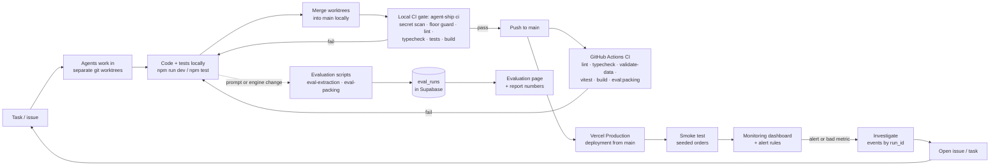
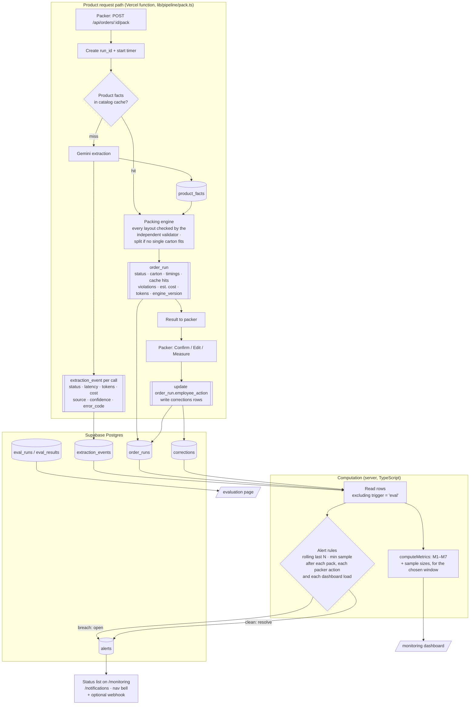
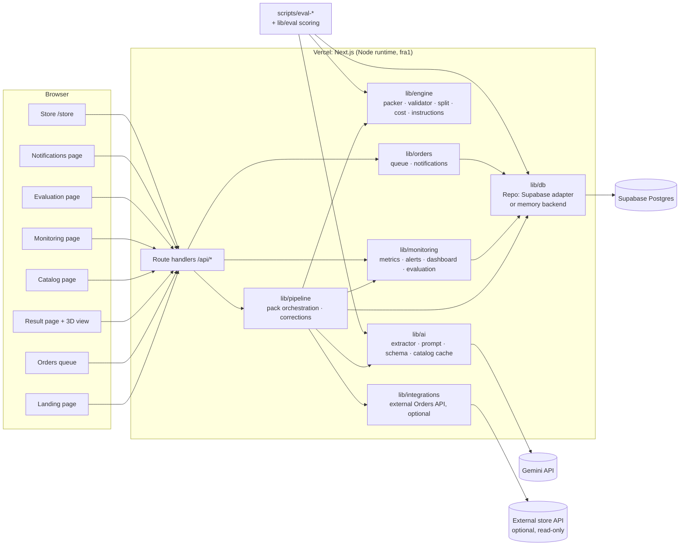

# Rassah: Technical Diagrams

The brief requires two diagrams: **Development Flow** and **Monitoring Flow**. Both must reflect the real implementation. If the implementation changes, update these diagrams in the same commit.

The diagrams are written in Mermaid, which GitHub renders natively. PNG exports live in `docs/report/` (`diagram-dev-flow.png`, `diagram-monitoring-flow.png`, `diagram-monitoring-sequence.png`, `diagram-architecture.png`), rendered with `@mermaid-js/mermaid-cli` (mmdc). Re-export them whenever a block changes. The PNGs were last exported on 2026-10-21 (commit `4128fcd`); the Mermaid blocks below have changed since (alert re-evaluation, notifications, store, multi-carton split), so the PNGs need a re-export.

---

## 1. Development Flow (required)

How a change goes from idea to production, and how problems found in production feed back into development.



**How to read it:**
- No change reaches `main` without passing the local gate (`agent-ship ci`: secret scan, floor guard that blocks new lint suppressions or skipped tests, lint, typecheck, tests, build). GitHub Actions then re-runs CI on the pushed commit, and Vercel deploys production from `main`.
- We did not use per-PR branches, Vercel preview deployments or a PR review step: one integrator merged the worktrees locally and pushed to `main`.
- Prompt and engine changes are re-scored with the evaluation scripts before merging, so we can show *before/after* numbers.
- Production problems enter the same loop through the dashboard. They become issues, then tasks.

---

## 2. Monitoring Flow (required)

How events move from the product to the monitoring components, how metrics are calculated, and how results reach the dashboard or trigger alerts.

### 2a. Data flow



### 2b. Sequence for one order (uncached product)

```mermaid
sequenceDiagram
    autonumber
    actor P as Packer
    participant UI as Next.js page
    participant API as /api/orders/:id/pack
    participant DB as Supabase
    participant G as Gemini API
    participant E as Engine + Validator

    P->>UI: Open order #1002
    UI->>API: POST pack
    API->>DB: Load order, products, cartons, cached product_facts
    DB-->>API: 2 cached, 1 missing
    API->>G: generateContent(product text, JSON schema)
    G-->>API: JSON facts + usage tokens
    API->>DB: upsert product_facts
    API->>E: packOrder(items, facts, cartons)
    E->>E: search; validate every layout
    E-->>API: cheapest valid carton (or split, or no_box)
    API->>DB: insert order_run + extraction_events
    API->>DB: re-evaluate alert rules (open / resolve alerts)
    API-->>UI: carton + instructions + layout + run_id
    P->>UI: Confirm (or Edit a product)
    UI->>API: POST /api/runs/:runId/action
    API->>DB: update order_run, insert corrections, re-evaluate alerts
```

---

## 3. System architecture (supporting)



Pages are server components that read through `lib/` directly as well as calling the API routes; the arrows show the main data paths only.
