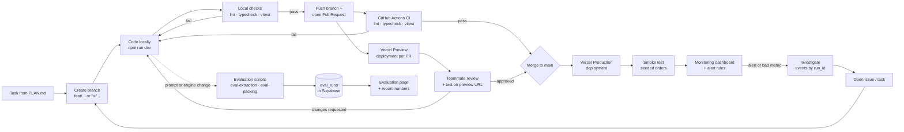
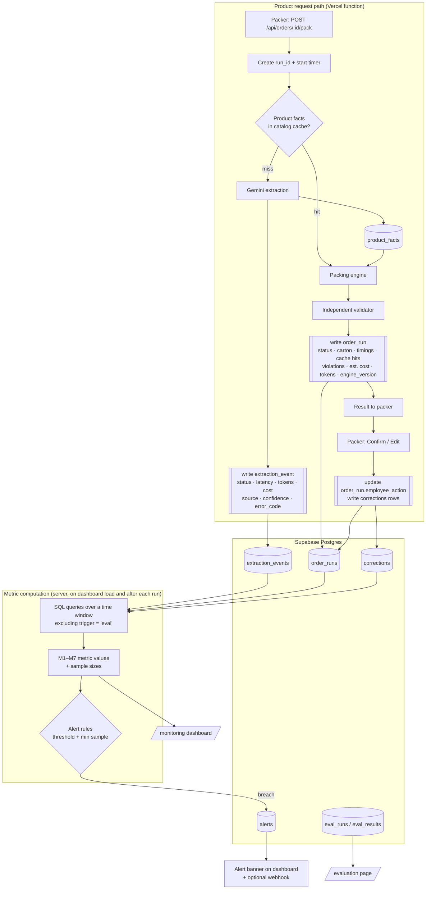
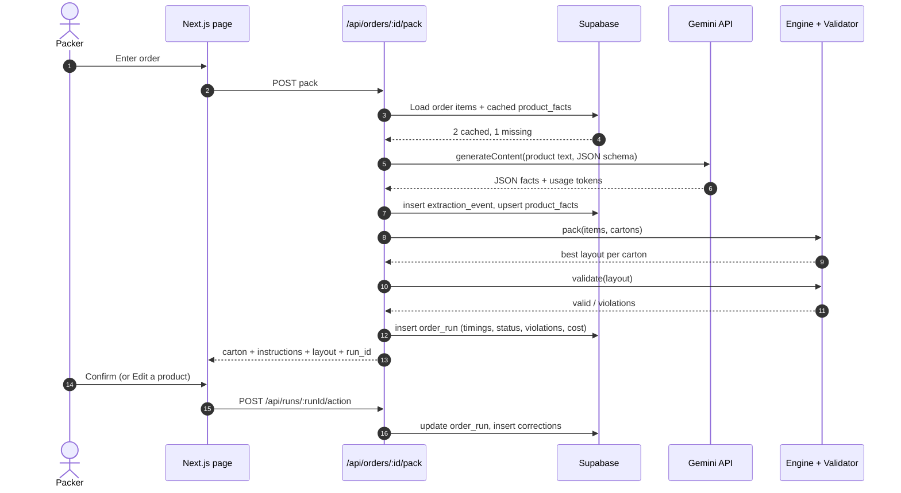
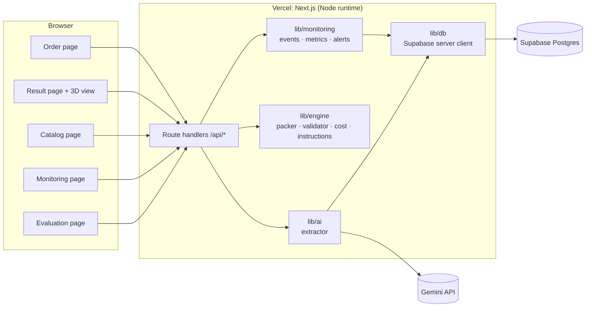

# Rassah: Technical Diagrams

The brief requires two diagrams: **Development Flow** and **Monitoring Flow**. Both must reflect the real implementation. If the implementation changes, update these diagrams in the same PR.

The diagrams are written in Mermaid, which GitHub renders natively. To export PNGs for the report and deck, paste each block into <https://mermaid.live> and download the image into `docs/report/`.

---

## 1. Development Flow (required)

How a change goes from idea to production, and how problems found in production feed back into development.

**Explaining it in Q&A:**
- No change reaches `main` without passing CI and a teammate's review on a live preview URL.
- Prompt and engine changes are re-scored with the evaluation scripts before merging, so we can show *before/after* numbers.
- Production problems enter the same loop through the dashboard. They become issues, then branches.

---

## 2. Monitoring Flow (required)

How events move from the product to the monitoring components, how metrics are calculated, and how results reach the dashboard or trigger alerts.

### 2a. Data flow

### 2b. Sequence for one order (uncached product)

---

## 3. System architecture (supporting)

