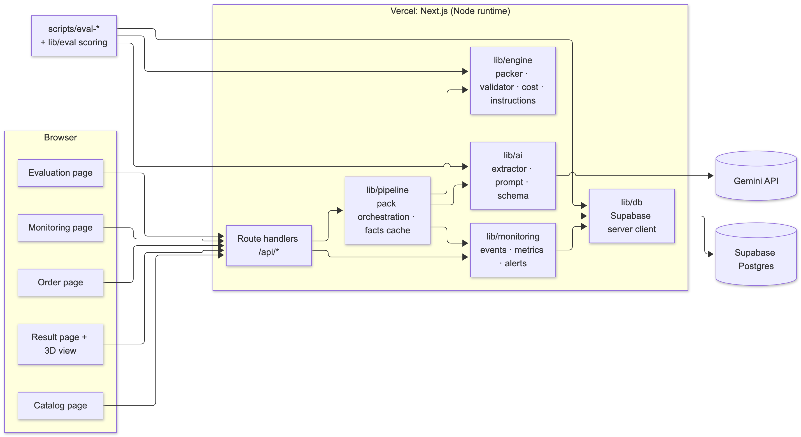
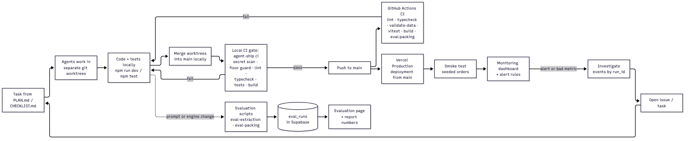
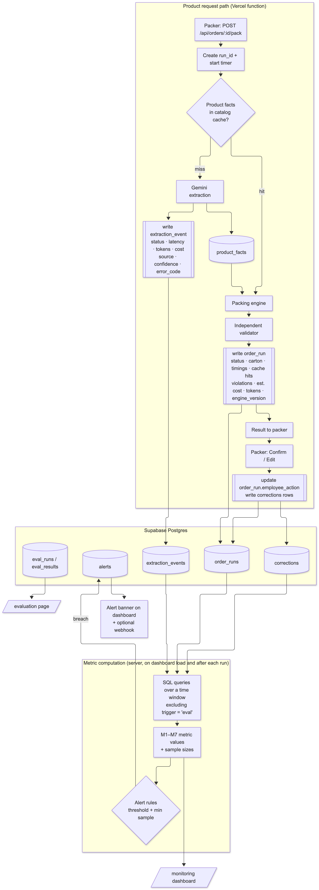
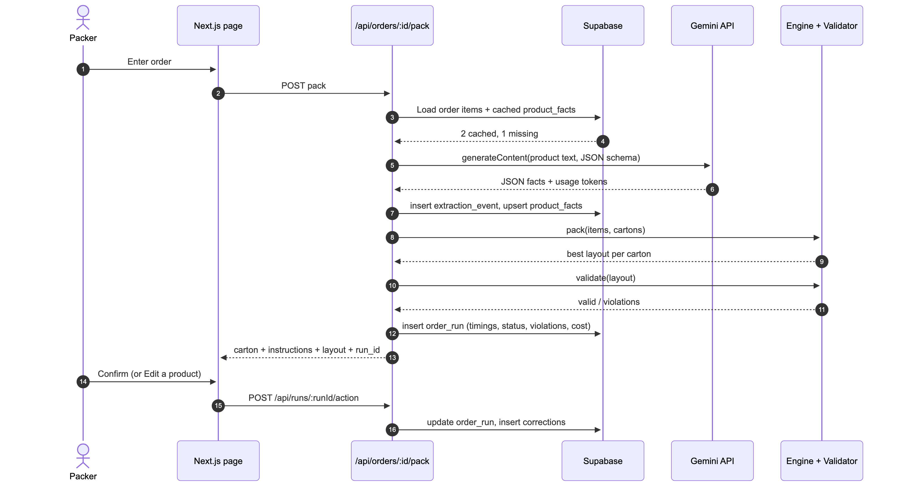

# Rassah (رصّة): AI Packing Assistant. Project Report

**Project 1: AI Product Development and Monitoring** · Tuwaiq Academy × Startupbootcamp × Meta · 22 October 2026
**Team:** M1 (AI & Data) · M2 (Engine & UI) · M3 (Platform & Monitoring)
**Live demo:** https://rassah.vercel.app · **Repository:** https://github.com/justAbdulaziz10/Rassah

> Status: **draft**. Items marked ⏳ wait on the deployed environment or outside inputs. Every number comes from `eval/results/*.json` or the dashboard.

---

## 1. Problem

Merchants who ship multi-item orders choose cartons by eye. Three things go wrong:

1. **Oversized cartons raise shipping cost.** Couriers bill the larger of actual and volumetric weight (`L × W × H / 5000`).
2. **Fragile items break and liquids leak.** A new packer puts a book on a perfume bottle, or lays an oil bottle flat.
3. **The data that would fix this doesn't exist.** Professional cartonization tools assume clean product dimensions in a warehouse system. Small Saudi merchants only have free-text product pages in Arabic and English.

**Validation status:** merchant outreach is in `docs/discovery.md`. ⏳ Report replies honestly. The problem size is a hypothesis we have not measured.

## 2. Solution and user flow

The packer types an order number. Rassah:

1. Loads the order's products. For each product not already cached, **Gemini reads the product page** and returns outer-package dimensions, weight, fragile / liquid / sensitive flags, where each value came from (*page*, *inferred*, *unknown*), confidence, and an evidence quote.
2. Runs a **constrained 3D packing search** over the carton catalog: gravity (≥ 70% base support), nothing on fragile items, liquids upright, weight limits, a safety margin on inferred sizes, and padding for fragile/sensitive items.
3. Gates every layout through an **independent validator**, then picks the cheapest valid carton by estimated carton + shipping cost.
4. Shows the carton, **numbered Arabic packing instructions**, a 3D step-by-step view, estimated cost, and per-product source badges. The packer **confirms or corrects**. Corrections are stored and measured.

If a value has no basis, the order stops with "needs measurement" (the packer measures once). If no carton fits within the search budget, it says so. It never invents a layout.

_Screenshots: ⏳ `docs/report/screens/` (orders, result + 3D, catalog, monitoring, evaluation)._

## 3. Where the AI is, and why

| Step | Technique | Why |
|---|---|---|
| Understand product pages | **LLM (Gemini)** with a JSON schema and honesty rules | Free-form Arabic/English text, mixed units, Arabic-Indic digits, implicit fragility ("كريستال") defeat rules |
| Arrange items | **Search** (classical AI): corner-grid candidates × rotations × 9 orderings/scores + 40 seeded restarts | An LLM cannot guarantee collision-free, supported coordinates |
| Prove validity | Independent validator (plain geometry) | Correctness checked by code that shares nothing with the search |

*"The LLM understands, the engine computes, the validator proves."* The instructor confirmed that using AI APIs meets the brief and that no fine-tuning is needed.

## 4. Data collection

- **Synthetic, stated openly.** 30 products written by the team in the style of Saudi store pages (no real merchant data):
  - **Group A (15):** dimensions and weight stated, in varied formats (Arabic-Indic digits, inches/lb, "الطول/العرض/الارتفاع", buried mid-paragraph).
  - **Group B (12):** clues only (50 ml, 400 pages, 12 pieces).
  - **Group C (3):** no usable information.
- **Ground truth** per product (outer box, natural upright orientation, flags, expected source). It must be reviewed by a member other than the description author (⏳ CHECKLIST P3.12). **10-product holdout** is excluded from prompt tuning.
- **20 orders** (incl. 3 demo orders, needs-measurement and impossible cases), **5 cartons**, synthetic shipping rates.
- **60 packing fixtures** from a seeded generator: 20 known-feasible (guillotine cuts of a carton, so a witness layout exists), 20 impossible (oversize / overweight / liquid too tall), 20 random.
- All data files are schema-validated in CI (`npm run validate-data`).

## 5. Technical design

Mermaid sources are in `docs/diagrams.md`. PNG exports:

*Figure 1. System architecture: pages → route handlers → pipeline → AI / engine / monitoring → Supabase.*

- **Stack:** Next.js 16 (App Router, Cache Components) + TypeScript strict on Vercel. Supabase Postgres. `@google/genai`. react-three-fiber. Recharts. Vitest.
- **Pack pipeline** (`lib/pipeline/pack.ts`): order → catalog cache (source-hash freshness; manual/corrected facts never overwritten) → Gemini for misses (concurrency 2, 20 s timeout, retries only on 429/5xx, SDK retries off) → engine → validator → `order_runs` + `extraction_events` → alert refresh. The result is returned even if monitoring writes fail (flagged "monitoring degraded").
- **Engine** (`lib/engine/`): pure TypeScript, no I/O, deterministic. Every rule exists twice: in the search, and in the independent validator.
- **Cost model:** carton + shipping on chargeable weight. Illustrative rates, always labeled "estimated".
- **Security:** service-role key server-only, RLS on all tables with no public policies, Zod on every input, demo controls only with `DEMO_MODE=true`, product text delimited as data in the prompt.
- **Offline fallback:** `DATA_BACKEND=memory` runs the whole app without Supabase (local only).

## 6. Development environment

Branch → PR → **GitHub Actions CI** (lint, typecheck with `next typegen`, data validation, 107 tests) + **Vercel preview** per PR → teammate review → merge → production deploy → smoke test → dashboard. Decisions are logged with reasons in `docs/decisions.md`. Progress is tracked in `docs/CHECKLIST.md` (517 tasks, 13 phases, gates). Exact dependency versions are pinned, and Node 24 LTS is set via `.nvmrc`.

*Figure 2. Development flow: branch → CI + Vercel preview → review → main → production → monitoring → issue.*

## 7. Selected metrics (monitoring)

| # | Metric | Reveals | Alert |
|---|---|---|---|
| M1 | AI correction rate (reviewed AI products the packer corrected) | Wrong extractions | > 20% of last 30, warning |
| M2 | Data-source mix of packed units | Missing store data | > 30% unknown in 24 h, info |
| M3 | Validator rejections of engine layouts | Engine bugs (must be 0) | any in 24 h, **critical** |
| M4 | No-carton rate + skip reasons | Catalog/margin mismatch | > 15% of last 20, warning |
| M5 | p50/p95 latency, cached vs uncached | Slow Gemini vs slow engine/DB | p95 > 8 s uncached / 2 s cached |
| M6 | Gemini failure rate by status | Key, quota, outage, bad output | > 10% of last 20, **critical** |
| M7 | Cost per order + cache-hit rate | Cache broken, prompt bloat | (shown) |

Every metric shows its sample size and says "insufficient data" below its minimum. Eval traffic is excluded. Alerts open once per rule, auto-resolve, and post to a webhook (never for simulated faults). Each run has a trace (Gemini calls, tokens, timings, corrections).

*Figure 3. Monitoring flow: events written per run, metrics M1–M7 computed over a window, alert rules.*

*Figure 4. One order end to end (uncached product): what is written where.*

## 8. Benchmarks and evaluation results

**Packing** (60 fixtures, `eval/results/packing-2026-10-21-engine-0.2.json`):

| Metric | Result |
|---|---|
| Engine layouts passing the independent validator | **40 / 40 (100%)** |
| Known-feasible recall (zero-slack exact fills) | **20 / 20 (100%)** |
| False claims on impossible cases | **0 / 20** |
| Naive baseline layouts failing the validator | **20 / 28**: liquid tipped 17, on fragile 7, floating 2 |
| Mean cost saving vs baseline (both valid, n = 8) | 0 SAR (**no savings claimed**) |
| Runtime p50 / p95 | 0.3 / 12.9 ms |

**Evaluation-driven iteration:** recall 3/20 (extreme points) → 9/20 (corner grid + seeded restarts; more restarts gave no gain) → 15/20 ("tight" placement scores, found by diagnosing fixture `feasible-05`) → **20/20** (engine-0.2: backtracking anchor search for the exact fills the greedy passes missed). The 0 SAR saving is by construction (both pick the cheapest fitting carton), not a bug.

**Extraction** (`eval/results/extraction-2026-10-21-v1.json`, `gemini-3.5-flash-lite`, prompt v1, 30 synthetic products, 30/30 calls ok):

| Metric | All (30) | Tuning (20) | Holdout (10) |
|---|---|---|---|
| Parse success | 100% | 100% | 100% |
| Dims within 1 cm / weight within 10% (group A) | 100% / 100% | 100% / 100% | 100% / 100% |
| Inferred dim MAPE (group B) | 14.3% | 12.3% | 18.2% |
| Inferred weight MAPE (group B) | 14.0% | 16.8% | 8.3% |
| Source correctness | 100% | 100% | 100% |
| Honesty on no-info products | 100% | 100% | 100% |
| Fragile recall / precision | 100% / 100% | 100% / 100% | 100% / 100% |
| Liquid accuracy | 100% | 100% | 100% |
| Avg latency / tokens | 1363 ms / 631 | 1425 ms / 628 | 1239 ms / 636 |
| Cost per product | $0.000449 | $0.000444 | $0.000458 |

**Prompt iteration:** none. Tuning-set failures were limited to estimate error on inferred products (no extraction failures), so the prompt stays `v1` and there is no before/after row.

**Margin decision:** inferred dim MAPE over all 12 inferred products is 14.3%, rounded up to 15%, so `MARGIN_INFERRED` stays 0.15. The holdout MAPE (18.2%, 4 products) is above 15%. With so few inferred products this is noisy, and the instructions already say "check the fit". A real-merchant pilot should re-measure it before the margin is trusted or raised.

**Model:** `gemini-3.5-flash-lite` ($0.30 in / $2.50 out per 1M tokens, 2026-10-21). The faster-tier models had a free quota of 20 requests/day, too low for a 30-call eval.

## 9. Monitoring in action

- **Investigation (real):** the packing eval and its fixture trace led to the scoring fix above. A regression test guards it.
- **Live demo:** a simulated Gemini outage (demo toggle) turns uncached products into "needs measurement" while cached ones still pack. M6 crosses 10% → critical banner "(عطل تجريبي)". The run trace shows `simulated_outage`. The alert resolves after clean runs.
- ⏳ Add any live-dashboard finding from the deployed app.

## 10. Tools and AI usage

Summary of `docs/report/TOOLS.md`: Gemini is the runtime AI feature. Claude (Claude Code) generated most code drafts, the docs and the synthetic data, all reviewed by the team and verified by tests, CI, evals, an end-to-end API run and screenshots. Every member walks through code they didn't write (CHECKLIST P11.44–P11.49).

## 11. Limitations

Synthetic data. Rigid box-shaped products only (no clothing). One carton per order. Illustrative costs. No live Salla/Zid integration. Time-bounded heuristic (not globally optimal; 5/20 exact-fill misses). No crush/stacking-load or void-fill modeling. The 70% support and 1.5 cm padding are assumptions.

## 12. Next steps

Pilot with one merchant (100 real orders, packer vs Rassah: carton spend, courier invoices, damage, packing time). Salla/Zid integration. Multi-carton orders. Manufacturer-spec lookup. Scale-weight feedback to catch bad facts. Separate preview/production databases.

## 13. References

- Project 1 brief (Tuwaiq Academy × Startupbootcamp × Meta), October 2026.
- Google Gen AI SDK for JavaScript (`@google/genai`) and the Gemini API docs (structured output, pricing). Pricing as of 2026-10-21.
- Next.js 16 documentation (Route Handlers, Cache Components), bundled in `node_modules/next/dist/docs/`.
- Supabase docs (Postgres, RLS, JS client). Vercel docs (deployments, function limits).
- Paccurate API documentation: existing cartonization product (positioning).
- py3dbp (github.com/enzoruiz/3dbinpacking, MIT): reference for the naive first-fit baseline idea. Our code is independent TypeScript.
- Courier volumetric-weight divisor: ⏳ cite the courier page used for 5000.
- ⏳ Any 3D bin-packing paper the team actually reads (cite only what was read).
